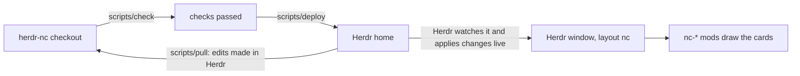
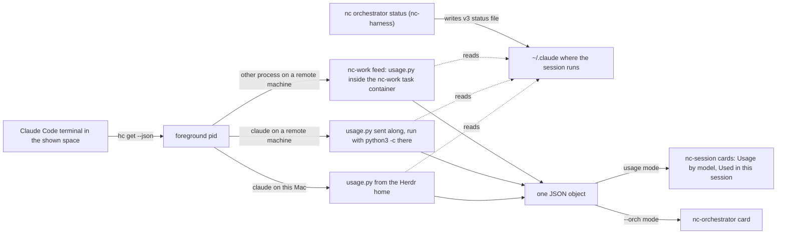

# herdr-nc

A workspace configuration for the [Herdr](https://herdr.dev) desktop app
([herdr-app](https://github.com/herdrdev/herdr-app), macOS): one layout, nine `nc-*` mods, two
themes, keys, settings and menu entries. It sets Herdr up for working with Claude Code sessions.
The left sidebar shows spaces, agents, the folder and the git history the agent works in. The
middle holds tabs and terminals. The right rail shows what the followed Claude Code session is
doing: its orchestration flow or plan, its cost by model, and the tools and files it used. Below
that, it lists the dev servers running in your project folders.

Herdr reads its configuration from its home folder, `~/.config/herdr-app/` (or
`$HERDR_APP_HOME`), called the Herdr home below. This repo is the source; `scripts/deploy` copies
it there. Nothing here is a fork of Herdr: the mods are plain Herdr mods, three of them modified
copies of Herdr's own (see [Licence](#licence)).

<!-- Screenshots go here. Make them from the mods' demo fixtures only (made-up data),
     never from a live window. -->

Terms used below:

- **Mod**: a folder with `mod.json` and `main.js` that Herdr loads from `mods/` in its home.
- **Card**: the block a mod draws in the layout, for example the Spaces card or the Usage card.
- **Space**: Herdr's group of tabs and terminals for one piece of work, on this Mac or on a remote
  machine. The shown space is the one open in the window.
- **`hc`**: the CLI of herdr-core, which runs every terminal and agent behind the Herdr window.
  The mods use it for machines and agent state.
- **Followed session**: the Claude Code agent of the shown space that the rail cards follow.
- **Feed**: `mods/nc-session/usage.py`, the script that reads a Claude Code session's files and
  prints one JSON object for the rail cards.

Crew, musts and the overlay come from the nc-harness orchestrator; see the
[nc-harness README](https://github.com/iAmSerathion/nc-harness).

## Architecture



You edit the files here, `scripts/check` validates them and `scripts/deploy` copies them into the
Herdr home. Herdr watches that folder and applies each file live: the layout `nc` places the cards,
and each card is drawn by one mod. Settings you change inside Herdr (settings window, layout
commands) land in the Herdr home; `scripts/pull` brings them back into the repo.

The layout `nc` has three columns:

| Column | Blocks, top to bottom |
| --- | --- |
| Left sidebar | `nc-workspace-chrome` bar, then the cards Spaces (`nc-spaces`), Agents (`nc-agents`), Folders (`nc-folders`), Git (`nc-git`), then Herdr's own `workspace-chrome` footer |
| Middle | Herdr's `tabs`, the terminals with Herdr's `files` and `changes` panel, the `nc-cards` bar, Herdr's `workspace-status` line |
| Right rail | Orchestrator (`nc-orchestrator`), Usage and Used (`nc-session`), Servers (`nc-servers`) |

What each mod shows and reads is in [Mods](#mods).

### How the rail follows a Claude Code session



The two rail mods that follow Claude Code (`nc-session` and `nc-orchestrator`) share the feed:

1. Each card picks the Claude Code agent of the shown space: the focused one, else the one it
   already follows, else the one with the highest `seq` (Herdr's counter, higher means changed
   more recently).
2. It asks `hc get <address> --json` (on the agent's machine) for the terminal's foreground
   process.
3. It runs the feed with that pid:
   - On this Mac the foreground must be `claude`. The feed runs from the Herdr home.
   - On a remote machine added with `hc machine add`, a `claude` foreground gets the script text
     as one argument (`python3 -c`). So nothing besides `/usr/bin/python3` (and `hc`, reachable
     from the login shell) is needed there.
   - Any other foreground on a remote machine may be an isolated session. The card asks
     `nc-work feed` there, which finds the nc-work task (one rootless container per task) behind
     the terminal and runs the same script inside it. Its answer is the same JSON, or
     `{"error": "not-isolated"}`.
4. The feed reads files under `~/.claude` where the session runs and prints one JSON object. With
   `--since <sig>` it prints only `{"v":1,"unchanged":true,...}` when no file changed, so the cards
   poll cheaply: `nc-session` every 5 s while the agent works and every 30 s otherwise,
   `nc-orchestrator` every 3 s while the session or a workflow runs and every 15 s otherwise.

### How the feed works

`/usr/bin/python3 -I -B mods/nc-session/usage.py` has two modes and a self-test:

| Mode | Arguments | Output |
| --- | --- | --- |
| usage | `--pid <pid> [--since <sig>]` | tokens and estimated cost per model (main agent and subagents apart), tools, skills, connectors, files edited and read |
| orchestrator | `--pid <pid> [--since <sig>] --orch` | the flow (prompt, crew, branches, steps, outcome), workflows, Agent-tool subagents, and the plan from a status file |
| self-test | `--selftest` | asserts on the prices and on a temporary `~/.claude`-like folder |

It reads, and never writes:

- `~/.claude/sessions/<pid>.json` for the session id, folder and status (never the `*.key` files
  next to it),
- the main transcript under `~/.claude/projects/`, the subagent transcripts and the workflow
  records of that session,
- in `--orch` mode, the status file `~/.claude/nc-orchestrator/<sessionId>.json`.

It prints only ids, labels, model ids, counts, statuses, times, tool, skill and connector names,
file paths (usage mode) and the first line of the latest typed prompt, at most 100 characters
(orchestrator mode). Never message text, tool results or file contents. It has no network access.
Costs are an estimate at API list price (the price table and its date are in `usage.py`, and the
card shows the date), not a subscription bill.

### The orchestrator plan view

The nc-harness orchestrator (crew one, pair or team) publishes its state with
`nc orchestrator status` to `~/.claude/nc-orchestrator/<sessionId>.json` with `"v": 3`. When that
file exists and is less than 6 hours old, the feed adds it to the flow, and the
`nc-orchestrator` card shows the plan instead of the derived stages:

- the crew and its reason, and the plan state (`planning`, `awaiting_approval`, `running`,
  `closing`, `done`, `error`),
- the musts (M1, M2, ...) as badges,
- phases with their lanes and tasks; each task shows its status (`pending`, `running`, `review`,
  `redo`, `pass`, `fail`, `blocked`, `conflict`), redo count, proof, files and its must answers
  (kept or broken), linked to the subagent whose description starts with the task id,
- an "Approve plan" button while the plan waits. It runs `hc send --json <address> ok`, and only
  once `hc get` says the agent is idle or done.

It also sends toasts when a task fails, when the plan waits for approval and when the
orchestrator is done or stops with an error. The card never writes the file.

Your own skill or hook can drive the diagram too: a status file with `"v": 1` and the optional
keys `prompt`, `routes`, `route`, `steps` and `outcome` replaces the derived flow. Other versions
are ignored. Format and limits: [`mods/nc-orchestrator/RECIPE.md`](mods/nc-orchestrator/RECIPE.md),
section "Driving the diagram from your own skill: the v1 status file".

### How deploy works

`scripts/deploy` runs `scripts/check` first, then copies the files this repo owns (`keys.json`,
`settings.json`, `programs.json`, `layouts/`, `themes/` and every file under `mods/`) into the
Herdr home. Herdr picks up each file live.

- It copies only what changed. Each file is written next to its target and renamed into place,
  so Herdr never reads a half-written file. Mods go first, then themes, then layouts, then keys
  and settings.
- It keeps a record of what it deployed, per target home, in `local/` (not in git).
- A file in the home that never came from this repo (for example your own `keys.json`) is left
  alone and reported as "Left alone". `scripts/deploy --force` takes it over and puts the old file
  in `local/backup/`.
- A deployed file that Herdr changed since (settings window, layout commands) stops the whole
  deploy. `scripts/pull` brings the change into the repo; `--force` overwrites it, with a backup.
- Files under `layouts/`, `themes/` and `mods/` that left the repo are removed from the home,
  unless they were changed there. `keys.json`, `settings.json` and `programs.json` are never
  removed.
- At the end it asks a running Herdr for its status and prints `errors []` when Herdr accepted
  everything, or the `*.error` files Herdr wrote.

Symlinks into the Herdr home do not work well: linked mod folders load without hot reload
(herdr-app#887), and linked JSON files take effect only after up to about 10 s (herdr-app#65).

## Requirements

- macOS
- [herdr-app](https://github.com/herdrdev/herdr-app), tested with 0.1.16 (the copied mods track
  that release; see [Updating Herdr](#updating-herdr)). Start it once so it creates its home.
  The `herdr-app` and `hc` commands must be on PATH; without `herdr-app`, `scripts/check` skips
  `herdr-app check` and `scripts/deploy` cannot report Herdr's status.
- [Claude Code](https://claude.com/claude-code) for `nc-session`, `nc-orchestrator`, `nc-folders`
  and `nc-git` (they read its session and transcript files under `~/.claude`)
- `python3` (the macOS `/usr/bin/python3` is enough) for `usage.py` and `scripts/check`
- `jq` for the scripts (`brew install jq`), `curl` for `scripts/fetch-upstream`

Optional:

- Remote machines added with `hc machine add`: `nc-spaces` groups their spaces, and
  `nc-session` and `nc-orchestrator` follow Claude Code sessions there. They need
  `/usr/bin/python3` and `hc`, reachable from the login shell, on that machine.
- `nc` from [nc-harness](https://github.com/iAmSerathion/nc-harness) adds the "Harness" menu
  entries in `programs.json` and writes the status file behind the orchestrator's plan view.
  `nc-work` from [nc-infra](https://github.com/iAmSerathion/nc-infra) adds the "isolated" menu
  entries and the broker, and lets the rail follow isolated sessions on remote machines. Without
  them those menu entries show as not installed; everything else works.
- `nc-orchestrator` needs `nc-session` (it runs `nc-session/usage.py --orch`).

## Install

```sh
git clone https://github.com/iAmSerathion/herdr-nc
cd herdr-nc
scripts/check              # validates JSON, names, themes and mods
scripts/deploy --dry-run   # shows what would be copied into ~/.config/herdr-app
scripts/deploy
```

Then switch to the layout `nc` in Herdr with `cmd-shift-l` (`layout.switch`).

**Emergency exit:** `ctrl-alt-shift-escape` in Herdr always sets the shown layout and
`keys.json` aside and goes back to Herdr's default layout `main`.

To try it without touching your real Herdr home, point the scripts at another one:
`HERDR_APP_HOME=<folder> scripts/deploy` (the folder must exist). Each home gets its own deploy
record. Herdr uses that folder as its home when it is started with the same `HERDR_APP_HOME`; the
sandbox paragraph in [`CLAUDE.md`](CLAUDE.md) lists what else to keep apart.

## What is in the repo

```
layouts/nc.json       the layout
mods/nc-<name>/       mods: mod.json ("place": "none") + main.js + RECIPE.md
themes/nc-*.json      themes, dark and light
keys.json             all keys
settings.json         zoom, sounds, no ligatures, telemetry off
programs.json         extra programs in the menu
scripts/              check, deploy, pull, selftest, fetch-upstream, contrast.py, lib.sh
local/                not in git: deploy records, backups, local/upstream/
```

### Layout

`layouts/nc.json` grew from Herdr's default layout `main`; its columns are in
[Architecture](#architecture). It picks `nc-dark` or `nc-light` with macOS and moves the Mac
window buttons out of the window with a negative `traffic_lights: [-200, -200]`. Herdr documents
the key, but not values outside the window, so this may break on an update.

### Mods

| Mod | What it shows | Origin | What it reads and runs |
| --- | --- | --- | --- |
| `nc-spaces` | Spaces grouped by machine, "This computer" always visible, machines sortable by dragging | Copy of Herdr's `spaces` (0.1.16) | `hc machine ls`, git (read-only) |
| `nc-workspace-chrome` | The bar above the sidebar (search, sidebar toggle) without the Herdr logo | Copy of Herdr's `workspace-chrome` (0.1.16) | nothing |
| `nc-agents` | Herdr's agent list plus a row counting agents that need you, are done, working and idle | Copy of Herdr's `agents` (0.1.16) | nothing |
| `nc-folders` | The folder tree of the repo the agent works in, git status colours, files Claude edited or read, read-only preview | new | Claude session file and transcript tail, git status |
| `nc-git` | The git graph of the repo you work in, like `git log --graph`, with branch and tag chips | new | git log and refs (read-only); Claude session file and transcript tail to find the agent's folder |
| `nc-orchestrator` | The session's flow as a pipeline, or the v3 plan; workflows and subagents | new | `nc-session/usage.py --orch`, `hc get`, `hc send` (Approve plan) |
| `nc-session` | Usage by model with estimated cost; tools, skills, connectors and files used | new | `usage.py`, `hc get` |
| `nc-servers` | TCP ports listened on by programs started in a space or pane folder, a green dot when they answer HTTP | new | `lsof`, `curl` to the local port, `open` on click |
| `nc-cards` | A bar with one button per card and column to show or hide it | new | only `layout.toggle` and `layout.show` |

Every mod has a `RECIPE.md` with what it shows, how it behaves, its data sources and pitfalls.
`nc-session` and `nc-orchestrator` also have a `fixture.js` with made-up demo data.

### Programs

What each entry needs is in [Requirements](#requirements).

| Entry in `programs.json` | Name in the menu | Starts | Needs |
| --- | --- | --- | --- |
| `nc-claude` | Claude (isolated) | `nc-work here` | nc-infra |
| `nc-claude-direct` | Claude (Harness) | `nc claude` | nc-harness |
| `nc-opencode` | OpenCode (isolated) | `nc-work here --runtime opencode` | nc-infra |
| `nc-opencode-direct` | OpenCode (Harness) | `nc opencode` | nc-harness |
| `nc-broker` | Broker | `nc-work broker` | nc-infra |

"Isolated" starts the agent in an nc-work task. "Harness" starts it on the host through `nc`, with
the model from your overlay's `models.yaml` (Claude Code) or the OpenRouter key for that process
only (OpenCode). The broker serves `nc delegate` and `nc memory add` from inside tasks. Herdr's own
"Claude Code" and "OpenCode" entries stay as they are.

### Themes

`themes/nc-dark.json` and `themes/nc-light.json` are one theme in a dark and a light variant.
`layouts/nc.json` picks dark or light with macOS; `"theme"` in `settings.json` or the theme picker
apply it to other layouts. `scripts/check` runs `scripts/contrast.py` so the colour pairs that
matter stay readable.

### Keys

`keys.json` is Herdr's macOS default from 0.1.16 plus two global keys: `cmd-alt-m`
(`window.maximize`) and `cmd-ctrl-w` (`window.close`). It is the whole file. As long as it is
byte-identical to Herdr's default, Herdr replaces it with the new defaults on update. From the
first change on (whitespace too) it stays as it is, and new defaults come in by hand. If `deploy`
reports drift in `keys.json` after an update, use `scripts/pull`, not `--force`.

On non-US keyboard layouts, shortcuts with `[ ] / = +` may not be reachable. Prefer letters or
digits for new shortcuts and try them out in Herdr.

### Scripts

| Script | What it does |
| --- | --- |
| `scripts/check` | Validates JSON, names, themes and mods; see the list below |
| `scripts/deploy [--dry-run] [--force]` | Copies the repo into the Herdr home (see [How deploy works](#how-deploy-works)) |
| `scripts/pull` | Takes changes Herdr made in its home (keys, settings, programs, deployed layouts and themes, new `nc*` layouts) back into the repo; never touches mods |
| `scripts/selftest` | Tests `deploy` and `pull` on a temporary copy against temporary homes |
| `scripts/fetch-upstream <version>` | Downloads Herdr's shipped defaults for a release into `local/upstream/herdr-app-<version>/`, for comparing and merging |

`scripts/check` fails on:

- invalid JSON, duplicate layout ids, mods in the layout that are neither in the repo nor shipped
  by Herdr,
- names other than `nc` or `nc-...`, theme colour pairs below the contrast minimum,
- a mod without `main.js`, or without `mod.json` with `"place": "none"`,
- a failing `herdr-app check` for any mod, or a failing `--selftest` of a Python helper that has
  one (`usage.py`),
- `setTimeout` or `setInterval` in mod code,
- absolute home paths and strings that look like keys or tokens.

It warns on hex colours in mod code and on git calls without `--no-optional-locks`.

## Adapting it

### Working on it

1. Change it in the repo.
2. `scripts/check` must say "check passed".
3. `scripts/deploy --dry-run`, then `scripts/deploy`. It reports Herdr's errors afterwards
   (`errors []` means good).
4. Look at it in Herdr (layout `nc`).

After changes to `scripts/`: `scripts/selftest`.

House rules, enforced by `scripts/check` where possible:

- Everything here is named `nc` or `nc-...`, so it never collides with Herdr's names or other
  people's mods.
- `mod.json` always has `"place": "none"`.
- Colours only through `theme()` tokens; no `setTimeout` or `setInterval` (Herdr's `cx.timer`
  instead); git only read-only, with `--no-optional-locks`.
- Images, fonts and sounds live in the folder of the mod that uses them and are referenced with
  paths relative to the Herdr home (`mods/nc-x/image.png`), so `deploy` takes them along.
- Mod names are permanent: Herdr stores mod panes with their tab, and renaming a mod breaks them.

[`CLAUDE.md`](CLAUDE.md) has the full rules for coding agents and contributors.

### Copying and changing a Herdr mod

Herdr's own mods and layouts are replaced on every start. So change them only as a copy:

1. `scripts/fetch-upstream <version>`, then copy `local/upstream/herdr-app-<version>/mods/<name>`
   to `mods/nc-<name>`.
2. In `mod.json`, add `"cloned_from": { "name": "<name>", "version": "<version>" }`; at the top
   of `main.js`, add `// Modified from herdr-app v<version> mods/<name> (Apache-2.0); see NOTICE.`
   and list the mod in `NOTICE`.
3. In the code, switch own paths `mods/<name>/...` and overlays that open themselves
   (`openOverlay({ mod: "<name>" ...`) to `nc-<name>`. Herdr's `mod.clone` does the same.
4. Switch every place that calls the mod:
   - in the layout `"mod": "<name>"`, root `"toast"` and `"terminal_menu"`
   - in `keys.json` `mod.open:<name>`, the section `mod:<name>` and `<name>.<command>`

   Mods that open other Herdr mods by name (for example `new-menu` from `tabs`, `picker`)
   take effect only once the caller is copied too.

A copy no longer gets fixes from Herdr. So copy only what you really change.

### Updating Herdr

Herdr updates itself. Afterwards fetch the old and the new release and compare them:

```sh
old=0.1.16; new=0.1.17   # new: see herdr-app --version
scripts/fetch-upstream $old && scripts/fetch-upstream $new
diff -r local/upstream/herdr-app-$old local/upstream/herdr-app-$new | less
```

- API changes are in the diff of `AGENTS.md` and `herdr.d.ts`; Herdr writes the current
  `gpui-kit.d.ts` into `~/.config/herdr-app/`.
- Take new default keys into `keys.json` by hand.
- Merge fixes into copied mods, for every changed file of the mod:
  `git merge-file mods/nc-x/main.js local/upstream/herdr-app-$old/mods/x/main.js local/upstream/herdr-app-$new/mods/x/main.js`
  - The exit code is the number of conflicts.
  - Afterwards switch the new lines back to `nc-x`:
    `grep -n 'mods/x/\|mod: "x"' mods/nc-x/*.js`
  - Update `cloned_from`, the header line and `NOTICE` to the new version.
- `scripts/check`, `scripts/deploy`, look at it in Herdr.

## Security and privacy

- The mods only read. git runs read-only with `--no-optional-locks`; the feed writes no files and
  opens no network connection. The only input sent to an agent is `hc send --json <address> ok`
  from "Approve plan". Everything else is Herdr UI commands (focus, peek, pin, show and hide
  cards, new space).
- `nc-servers` probes only the local ports it found with `curl -m 1`; nothing leaves the machine.
- Every command for a remote machine goes through Herdr's `exec(..., { on })`, which runs it there
  through herdr-core as an argument vector without shell quoting. `hc` and `nc-work` also go
  through that machine's login shell (`sh -lc 'exec "$@"' sh ...`), so PATH includes
  `~/.local/bin`. Terminal ids are checked against `[A-Za-z0-9_.:-]` before they go there.
- The feed never prints message text, tool results or file contents (see
  [How the feed works](#how-the-feed-works)).
- Live screenshots show your own folders, prompts and repos. Screenshots for docs come only from
  the demo fixtures, and `herdr-shot*.png` is in `.gitignore`.
- `scripts/check` fails on absolute home paths and on strings that look like keys or tokens.

## Read more

- `mods/<name>/RECIPE.md`, one per mod. The feed's JSON contract and the v3 status file are in
  [`mods/nc-orchestrator/RECIPE.md`](mods/nc-orchestrator/RECIPE.md) (section "The v3 status file
  (the orchestrator's plan)") and [`mods/nc-session/RECIPE.md`](mods/nc-session/RECIPE.md).
- [`CLAUDE.md`](CLAUDE.md): rules for coding agents and contributors.
- Herdr's API: `~/.config/herdr-app/AGENTS.md`, `herdr.d.ts` and `gpui-kit.d.ts`, written by Herdr
  on every start for the installed version.
- Sibling repos: [nc-harness](https://github.com/iAmSerathion/nc-harness) (the `nc` CLI, overlay,
  model policy, orchestrator and status file writer),
  [nc-infra](https://github.com/iAmSerathion/nc-infra) (`nc-work` tasks, egress proxy, key proxy,
  broker), [nc-memory-template](https://github.com/iAmSerathion/nc-memory-template) (the shared
  memory used by `nc memory`).

## Licence

Apache-2.0, see [`LICENSE`](LICENSE). Parts are derived from
[herdr-app](https://github.com/herdrdev/herdr-app) (Apache-2.0): the layout, `keys.json`, the
mods `nc-agents`, `nc-spaces` and `nc-workspace-chrome`, parts of `nc-folders` and `nc-git`, and
`nc-orchestrator/spinner.svg`. [`NOTICE`](NOTICE) lists each file with the herdr-app version it
came from.
